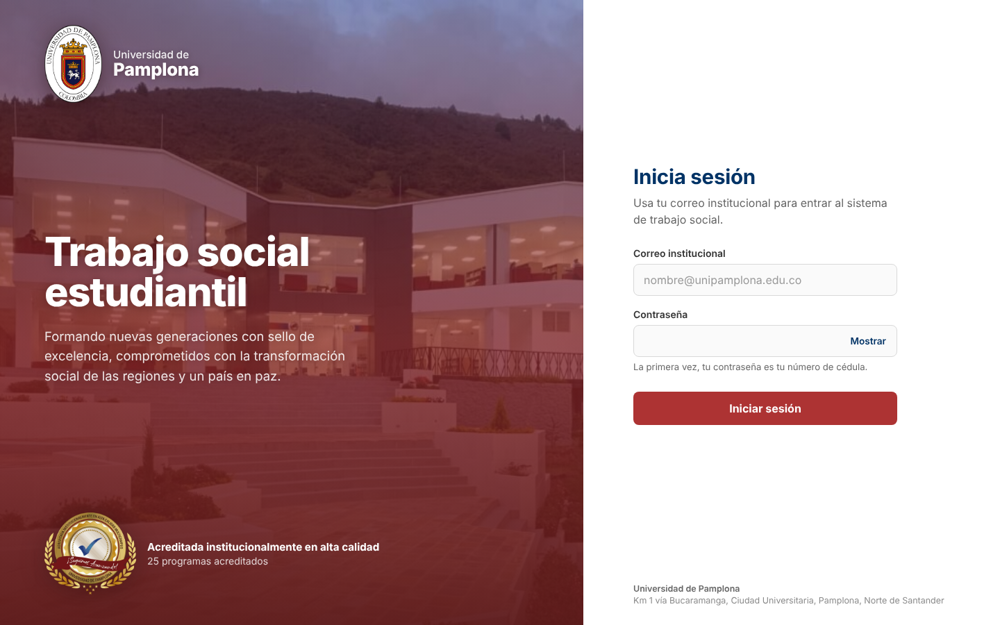
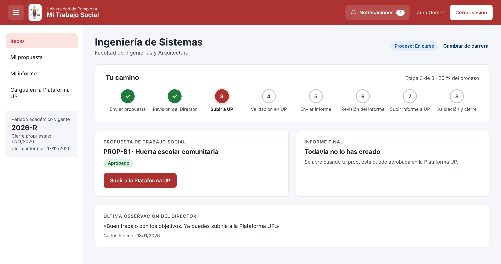
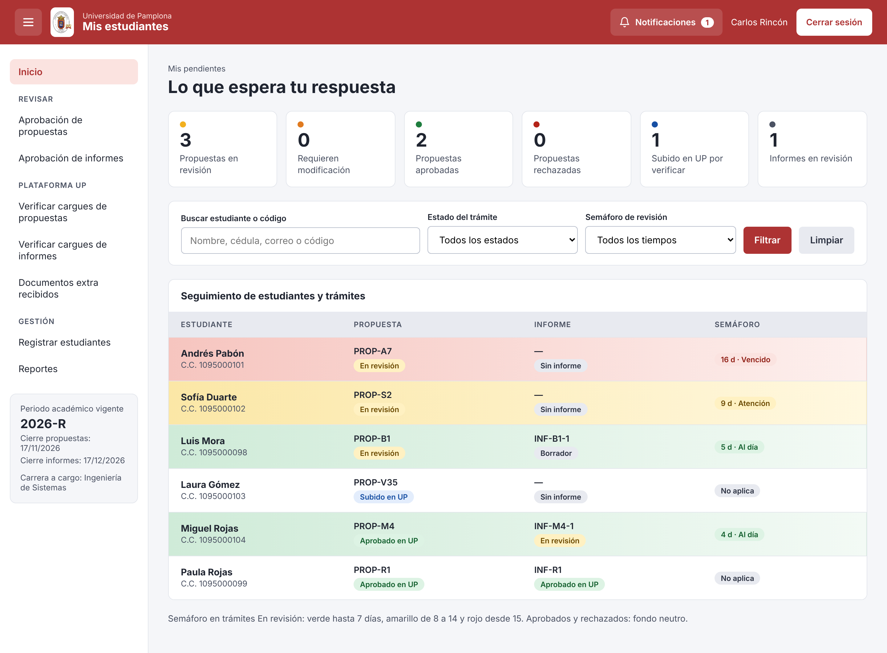
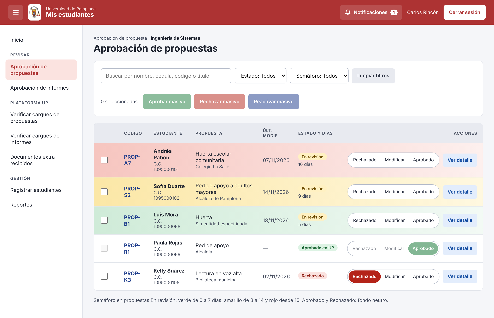

# Guía de diseño SISTRA-UP

23/11/2026 · Jorge Enrique Bohada Ardila (Product Owner)

## Para qué es y la regla principal

Todas las pantallas de SISTRA-UP pasan a un solo estilo, el que aprobó Jorge el 23/11. Cada responsable adapta las pantallas de su requerimiento con esta guía, para que el sistema se vea como uno solo.

**La regla: solo se cambia cómo se ve, no lo que hace.**

- Se puede cambiar el HTML de las plantillas (orden, contenedores, clases), el CSS y los textos de ayuda que no sean mensajes del BRD.
- No se tocan vistas, formularios, modelos, URLs, servicios ni permisos. Quedan igual los `name` de los campos, los ``, el ``, los `method="post"` y las variables que entrega la vista.
- No se cambian los mensajes del BRD (MSG-xx-xx) ni los nombres de los estados.
- Si una pantalla necesita un dato que la vista no entrega, no se calcula en la plantilla: se pide como tarea aparte (ver «Lo que no es solo diseño»).
- La base sigue siendo Django con Bootstrap 5.3 (RG-12), que ya carga `templates/base.html`. No se agregan librerías nuevas.

Las imágenes de referencia están en esta guía: la del login en su sección y las de las pantallas internas en «Pantallas de referencia».

## Login: el repositorio de referencia

El login ya está diseñado y se toma de [DeimonBot/Login](https://github.com/DeimonBot/Login). Es un proyecto aparte en Angular y Spring Boot: de él se copia el diseño, no el código.

**Direcciones (rama master):**

- Repositorio: [https://github.com/DeimonBot/Login](https://github.com/DeimonBot/Login)
- Pantalla del login: [frontend/src/app/pages/login](https://github.com/DeimonBot/Login/tree/master/frontend/src/app/pages/login)
- Colores: [frontend/src/styles.css](https://github.com/DeimonBot/Login/blob/master/frontend/src/styles.css)
- Imágenes: [frontend/public/img](https://github.com/DeimonBot/Login/tree/master/frontend/public/img)

**Mismas imágenes para todos.** Se copian tal cual, con el mismo nombre, a `static/img/` de SISTRA: `escudo.png`, `sello-acreditacion.png`, `campus-1.jpg`, `campus-2.jpg` y `contornos.svg`. El escudo de la franja de todas las pantallas es ese mismo `escudo.png`. Nadie usa otra versión del escudo, del sello ni de las fotos.

| Qué tomar | Dónde está en el repo |
| --- | --- |
| Estructura de dos lados: a la izquierda la portada roja con fotos del campus, escudo, lema y sello de acreditación; a la derecha el formulario | `frontend/src/app/pages/login/login.html` y `login.css` |
| Colores: `--primario #ad3333`, `--primario-hover #8f2828`, `--azul #003366`. Son los mismos de esta guía | `frontend/src/styles.css` |
| Escudo, sello, fotos del campus y la textura `contornos.svg`. El `LEEME.txt` dice qué se ve si falta alguna | `frontend/public/img/` |

**Dónde va en SISTRA:** `apps/usuarios/templates/usuarios/logueo/login.html` y `apps/usuarios/static/usuarios/css/logueo.css`. Recuperar contraseña y Cambiar contraseña, en la misma carpeta, llevan el mismo estilo.

**Qué no se copia:**

- El texto «La primera vez, tu contraseña es tu número de cédula». En SISTRA la contraseña temporal es aleatoria y llega al correo (RG-09). Se dejan los textos actuales de SISTRA.
- La lógica de Angular (`login.ts`, `auth.service.ts`, el guard) y el backend. El formulario sigue siendo el de Django: `{{ form.correo }}`, `{{ form.contrasena }}`, ``, el campo oculto `next`, los mensajes y el enlace «¿Olvidaste tu contraseña?».
- El botón «Mostrar» de la contraseña ya existe en SISTRA (`data-password-toggle`): se mantiene. El cambio de fotos se hace con un script corto en la plantilla y se prueba con clic real en el navegador.

**Responsable:** quien tiene SISTRA-13 (Logueo).

**Imagen 4 · Login de referencia (repo DeimonBot/Login).** La ayuda de la cédula debajo de la contraseña no se copia.



## Colores, letra y tamaños

Todos usan los mismos valores, guardados una sola vez en `static/css/sistra.css`, que carga `templates/base.html`. Nadie escribe colores sueltos en su plantilla: se usan estas variables.

| Uso | Variable | Color |
| --- | --- | --- |
| Rojo institucional: franja, botón principal, opción activa del menú | `--sistra-rojo` | #AD3333 |
| Rojo al pasar el mouse | `--sistra-rojo-hover` | #8F2828 |
| Rosado suave: fondo de la opción activa | `--sistra-rojo-suave` | #FBE3E0 |
| Enlaces | `--sistra-azul` | #003366 |
| Fondo de la página | `--sistra-fondo` | #F5F6F9 |
| Tarjetas, menú y campos | `--sistra-superficie` | #FFFFFF |
| Bordes de tarjetas y líneas de tabla | `--sistra-borde` | #E3E6EC |
| Borde de campos | `--sistra-borde-campo` | #B9BFCC |
| Texto principal | `--sistra-texto` | #1F2430 |
| Texto secundario | `--sistra-texto-suave` | #4B5263 |
| Botón secundario y encabezado de tabla | `--sistra-gris` | #E8EAF0 |
| Texto sobre gris | `--sistra-gris-texto` | #2A3040 |

**Letra:** IBM Plex Sans (pesos 400, 500, 600 y 700), la de las imágenes de referencia. Pregunta abierta para Jorge: el repo del login usa Montserrat; hay que elegir una sola para todo el sistema.

| Elemento | Tamaño | Peso |
| --- | --- | --- |
| Título de la pantalla | 28 px | 700 |
| Título de una sección o tarjeta grande | 19 px | 700 |
| Dato principal de una tarjeta | 18 px | 700 |
| Texto normal, campos y botones | 15 px | 400 / 600 |
| Texto secundario, ayudas, cédula debajo del nombre | 13 a 14 px | 400 |
| Rótulo en mayúsculas (tarjetas y encabezados de tabla) | 12 a 13 px, espaciado 0.06em | 600 |

**Formas y espacios:** tarjetas con radio de 12 px y 24 px de margen interno; botones con radio de 8 px y mínimo 44 px de alto; campos con radio de 6 px; pastillas de estado redondas (999 px). El contenido tiene 32 px de margen y los bloques se separan 20 a 24 px.

```css
:root {
  --sistra-rojo: #AD3333;
  --sistra-rojo-hover: #8F2828;
  --sistra-rojo-suave: #FBE3E0;
  --sistra-azul: #003366;
  --sistra-fondo: #F5F6F9;
  --sistra-superficie: #FFFFFF;
  --sistra-borde: #E3E6EC;
  --sistra-borde-campo: #B9BFCC;
  --sistra-texto: #1F2430;
  --sistra-texto-suave: #4B5263;
  --sistra-gris: #E8EAF0;
  --sistra-gris-texto: #2A3040;
  --sistra-letra: 'IBM Plex Sans', system-ui, sans-serif;
}
```

## Estructura común de todas las pantallas

Toda pantalla interna (Estudiante, Director y ADMO) tiene las mismas tres partes. Se arman una sola vez en `templates/base.html` y cada pantalla solo llena su bloque ``.

1. **Franja superior vino tinto** (`--sistra-rojo`), de borde a borde.
    - A la izquierda: el botón de tres barras que abre y cierra el menú (44 × 44 px, con `aria-label="Mostrar u ocultar el menú"` y `aria-expanded`), el escudo sobre fondo blanco y dos líneas: «Universidad de Pamplona» (12 px, rosado suave) y el nombre del panel en 18 px negrita, por ejemplo «Mi Trabajo Social».
    - A la derecha: el botón «Notificaciones» con campana y contador blanco, el nombre de la persona y «Cerrar sesión» como botón blanco con letra roja.
    - Cerrar sesión es el formulario POST que ya existe (`` con ``), nunca un enlace.
2. **Menú lateral plegable** (240 a 280 px, blanco, borde derecho `--sistra-borde`).
    - Se abre y se cierra con las tres barras. En celular empieza cerrado.
    - La opción actual va con fondo rosado suave, texto rojo y `aria-current="page"`.
    - Las opciones salen del menú por permisos que ya existe: `` (etiqueta `menu_por_permisos`). Ya trae los grupos con su título y solo muestra lo que cada rol puede usar. Se le cambia el estilo, no la lista, y debe seguir pasando `test_vistas_por_rol.py`.
    - Abajo va la tarjeta del periodo académico vigente con las fechas de cierre; el Director ve también la carrera a cargo.
    - En las imágenes, los grupos del Director se ven como rótulos pequeños en mayúsculas (Revisar, Plataforma UP, Gestión); los nombres reales son los que trae el menú.
3. **Contenido** sobre fondo `--sistra-fondo`, con 32 px de margen: arriba una línea pequeña de contexto (13 px, gris) y el título de la pantalla (28 px); debajo, tarjetas y tablas separadas 20 a 24 px.

**Notificaciones.** Se llaman «Notificaciones», no «Avisos». El botón abre un panel de 360 px debajo de la franja, con cada notificación y su enlace «Abrir». Usa los datos y la apertura que ya existen en el dashboard (`notificaciones`, `total_notificaciones`).

**Cómo se hace sin lógica nueva.** El menú plegable y el panel de Notificaciones se hacen con componentes de Bootstrap 5.3, que ya está cargado: `offcanvas` o `collapse` para el menú y `dropdown` para Notificaciones. Se prueban con clic real en el navegador.

**En celular:** el menú arranca cerrado, la franja se acomoda en dos líneas y las tablas se desplazan de lado dentro de su tarjeta. La página nunca se desplaza de lado.

## Componentes

Cada pieza se ve igual en todas las pantallas. Si una pantalla necesita algo que no está aquí, se arma con estas mismas piezas antes de inventar una nueva.

**Estados del trámite.** Siempre como pastilla redonda (12 a 13 px, peso 600), con el nombre del estado tal como lo entrega la vista.

| Estado | Fondo | Texto |
| --- | --- | --- |
| En revisión | #FFF1C2 | #6B4A00 |
| Requiere modificación | #FFE8D6 | #8F3E00 |
| Aprobado y Aprobado en UP | #DDF3E4 | #14612F |
| Subido en UP | #E3EDFC | #174FA3 |
| Rechazado | #FBE3E0 | #8E1C12 |
| Borrador, Sin informe y No aplica | #E8EAF0 | #2A3040 |

**Semáforo.** Se pinta la fila completa con un degradado y se pone una pastilla con los días. Solo aplica a trámites En revisión; los demás van con fondo blanco. Los días, el color y el texto salen de la vista (`evaluar_semaforo`: `nivel`, `etiqueta`); la plantilla solo escoge el color. Debajo de la tabla va una línea que explica los límites, que se configuran en Parametrización.

| Color | Fondo de la fila | Pastilla (fondo / texto) |
| --- | --- | --- |
| Verde | degradado #CFEBD8 a #F3FAF5 | #DDF3E4 / #14612F |
| Amarillo | degradado #FBE7A6 a #FFF8E0 | #FFF1C2 / #6B4A00 |
| Rojo | degradado #F6C5BF a #FDF0EE | #FBE3E0 / #8E1C12 |
| Sin semáforo | #FFFFFF | #E8EAF0 / #2A3040 |

**Botones.**

- Principal: fondo rojo, letra blanca, radio de 8 px, mínimo 44 px de alto. Uno solo por bloque: la acción que sigue.
- Secundario: fondo `--sistra-gris`, letra `--sistra-gris-texto`. Para Limpiar, Cancelar o Volver.
- Enlace: azul `--sistra-azul`, rojo oscuro al pasar el mouse. Para Ver detalle o Abrir.
- Decisión del Director: control de tres opciones juntas, Rechazado (#B42318, letra blanca), Modificar (#F2B01E, letra #2E2100) y Aprobado (#1E7D3E, letra blanca). Se deshabilita con la misma condición que hoy.

**Tarjetas.** Fondo blanco, borde de 1 px `--sistra-borde`, radio de 12 px y 24 px de margen interno. Arriba un rótulo en mayúsculas (13 px, gris) y debajo el dato en 18 px negrita.

**Tablas.** Van dentro de una tarjeta que se desplaza de lado si no cabe. El encabezado lleva fondo `--sistra-gris` y texto de 12 px en mayúsculas. Las filas se separan con una línea `--sistra-borde`. El nombre va en negrita y debajo «C.C.» con la cédula en 13 px gris.

**Filtros.** En una tarjeta arriba de la tabla, con la etiqueta visible encima de cada campo (13 px, peso 600). Los botones son Filtrar (principal) y Limpiar (secundario).

**Formularios.** Etiqueta arriba, ayuda debajo en 13 px gris y el error debajo del campo en rojo #B42318 con `role="alert"`. Se siguen usando `{{ form.campo }}` y `{{ form.campo.errors }}`.

**Mensajes.** Los `messages` de Django van arriba del contenido, con los colores de los estados: éxito en verde, advertencia en amarillo y error en rojo.

**Accesibilidad.** Cada campo tiene su `label`, el foco se ve, los botones miden por lo menos 44 px y nada depende solo del color: el semáforo siempre lleva texto.

## Pantallas de referencia

Hay tres pantallas modelo, cada una con su imagen. Las demás se arman copiando la que más se les parece.

| Pantalla | Toma como modelo |
| --- | --- |
| Inicio del Estudiante | Imagen 1 |
| Mi propuesta, Mi informe y Cargue en la Plataforma UP | Tarjetas de la imagen 1 |
| Inicio del Director | Imagen 2 |
| Aprobación de propuestas y Aprobación de informes | Imagen 3 |
| Verificar cargues, Documentos extra recibidos, Registrar estudiantes y Reportes | Imagen 3 (tabla con filtros) |
| Parametrización y Roles y usuarios (ADMO) | Imagen 3 para las listas; Componentes para los formularios |
| Login, Recuperar contraseña y Cambiar contraseña | Imagen 4 y repo DeimonBot/Login |

**Inicio del Estudiante (imagen 1).**

- Arriba, la carrera en 28 px y la facultad debajo; a la derecha, la pastilla del proceso.
- «Cambiar de carrera» solo aparece si el estudiante tiene dos o más carreras activas (B7).
- **Tu camino:** las etapas en una fila, cada una con su círculo de 40 px. Etapa hecha: círculo verde (#1E7D3E) con chulo. Etapa actual: círculo rojo con un halo rosado y el nombre en negrita. Etapas que faltan: círculo blanco con borde gris y número. Encima, a la derecha, «Etapa N de 8 · X % del proceso». Los nombres salen del catálogo de etapas de Parametrización, no se escriben en la plantilla.
- Dos tarjetas lado a lado, Propuesta e Informe final, con el código y el título, la pastilla de estado y un solo botón con la acción que sigue.
- Al final, la tarjeta «Última observación del Director», con el nombre y la fecha.

**Imagen 1 · Inicio del Estudiante**



**Inicio del Director (imagen 2).**

- Arriba «Mis pendientes» y el título «Lo que espera tu respuesta».
- Seis tarjetas de conteo con un punto de color: Propuestas en revisión, Requieren modificación, Propuestas aprobadas, Propuestas rechazadas, Subido en UP por verificar e Informes en revisión. Los números ya los entrega la vista.
- Filtros: buscar, estado y semáforo.
- La tabla «Seguimiento de estudiantes y trámites» con Estudiante, Propuesta, Informe y Semáforo, y cada fila pintada con su semáforo.

**Imagen 2 · Inicio del Director**



**Aprobación de propuestas (imagen 3, el panel de Leal).** Se conserva el panel de Leal tal como funciona y solo se le pone el estilo de esta guía.

- Arriba, el buscador y los filtros de estado y semáforo.
- Al lado, la barra de acciones masivas con cuántas hay seleccionadas: Aprobar, Rechazar y Reactivar masivo.
- La tabla lleva selección, Código, Estudiante, Propuesta con la entidad, Última modificación, Estado y días, y Acciones (las tres decisiones y «Ver detalle»).
- Es el modelo para Aprobación de informes, Verificar cargues y Registrar estudiantes.

**Imagen 3 · Aprobación de propuestas (panel de Leal)**



## Lo que no es solo diseño

Cinco cosas del diseño necesitan datos o una pieza común que hoy no existe. Esas no se resuelven en la plantilla de cada uno: van como tarea aparte, con su prueba, y las pantallas las usan cuando estén en develop.

| Qué | Por qué no es solo diseño | Quién |
| --- | --- | --- |
| Base común: franja, menú plegable y panel de Notificaciones en `templates/base.html`, y `static/css/sistra.css` | Es una sola pieza que usan todos. Se hace primero, una vez; mientras no esté, nadie arma su propia franja | Por definir (Jorge) |
| Notificaciones y periodo vigente en todas las pantallas | Hoy solo el dashboard los entrega (`notificaciones`, `periodo_vigente`). Para verlos en la franja y el menú de cualquier pantalla hay que entregarlos en todas, por ejemplo con una etiqueta como la del menú (`menu_por_permisos`) | Por definir (Jorge) |
| Tu camino: cuál etapa está hecha y cuál es la actual | `_calcular_avance_estudiante` en `apps/dashboard/services.py` entrega las etapas y el porcentaje, pero no el estado de cada una cuando no hay avance registrado por etapa; ahí el porcentaje sale de 6 hitos y las etapas son 8 | Johan y Jeyson (dashboard) |
| Etapa y Último envío en la tabla del Director | Ya está en el plan de cambios como R6 | Johan y Jeyson |
| «Cambiar de carrera» del Estudiante | Ya está en el plan de cambios como B7 | Daniel |

## Cómo se entrega y cómo se revisa

El orden es: primero la base común, después el login y después cada responsable sus pantallas encima de esa base. Se revisa antes del merge, comparando con las imágenes de referencia de esta guía.

Cada PR de diseño cumple esto antes de pedir revisión:

- [ ] Una rama por requerimiento desde develop, como las demás.
- [ ] Solo trae plantillas (`.html`) y CSS. Si trae un `.py`, se devuelve, salvo las tareas de «Lo que no es solo diseño».
- [ ] Usa las variables de `sistra.css`; no hay colores sueltos en la plantilla.
- [ ] Los formularios siguen enviando lo mismo: mismos `name`, ``, `method` y `action`.
- [ ] Pasan todas las pruebas del proyecto. Si una prueba buscaba un texto que cambió por diseño, se actualiza solo ese texto y se explica en la PR.
- [ ] Lo que tenga script (menú, Notificaciones, mostrar contraseña, fotos del login) se probó con clic real en el navegador.
- [ ] Trae capturas de antes y después en escritorio (1440 px) y en celular (390 px), sin desplazamiento de lado en la página.
- [ ] Sin emojis en textos, botones ni mensajes.
